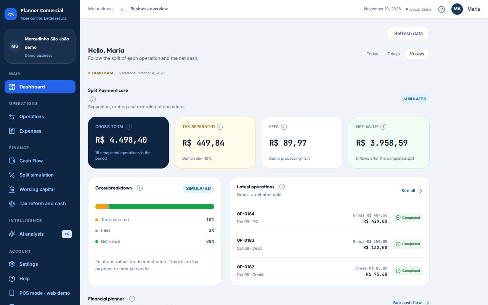
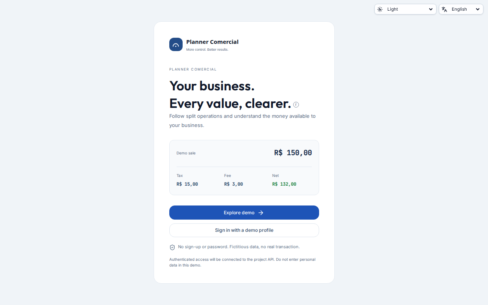
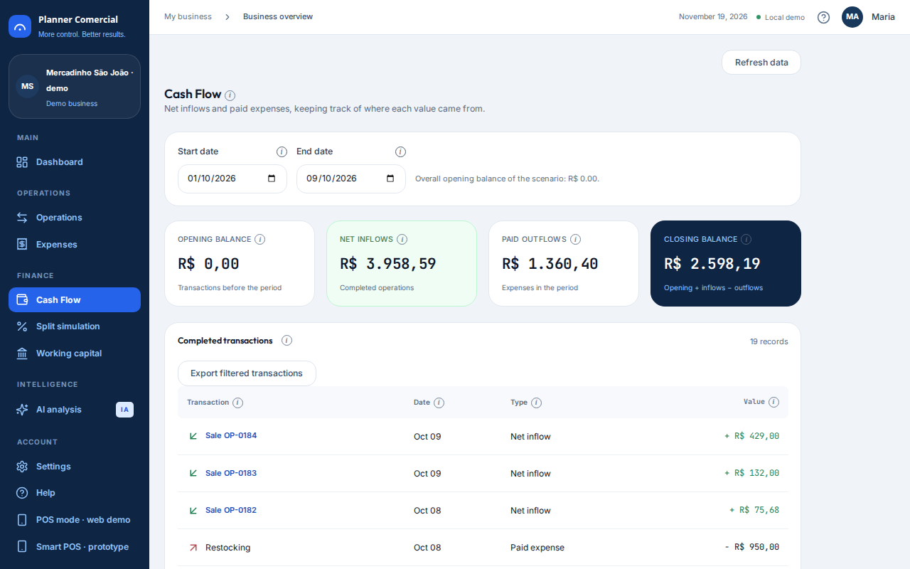
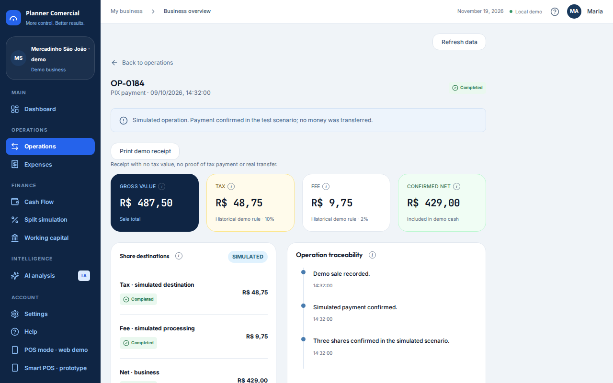
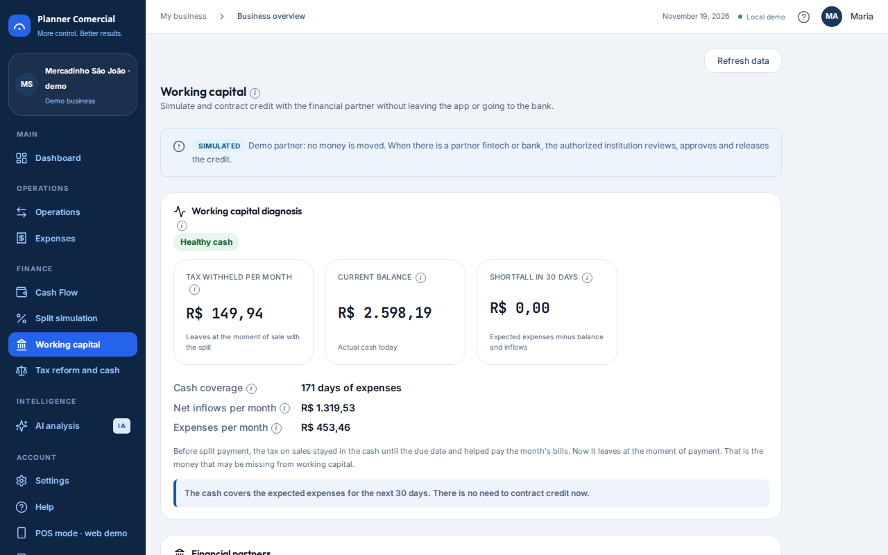
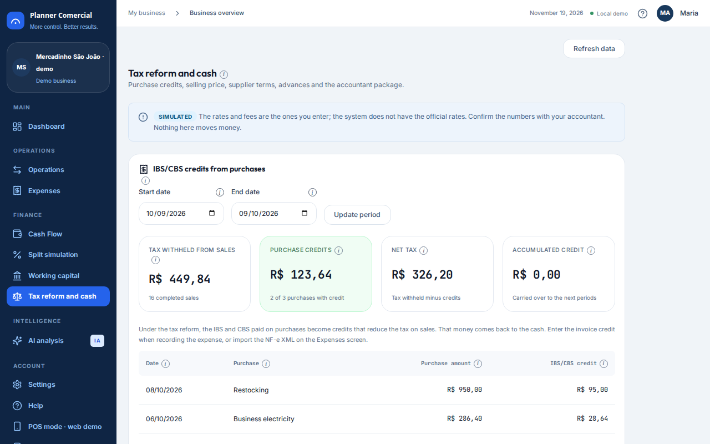
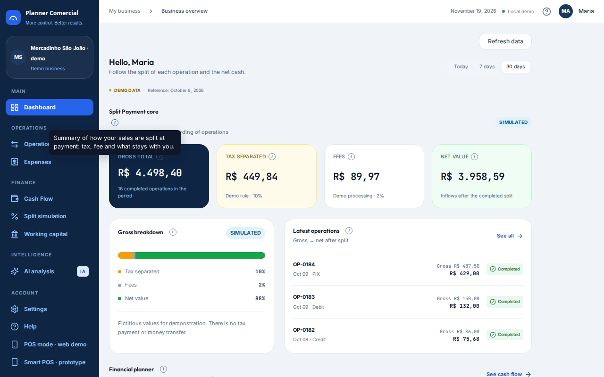
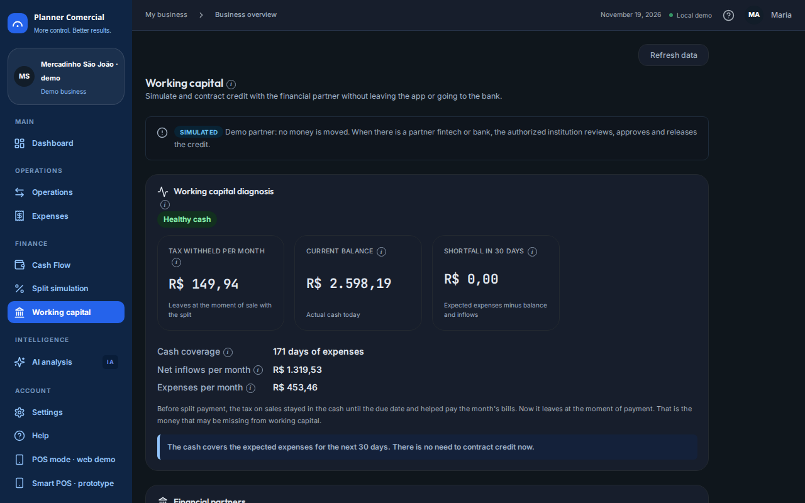
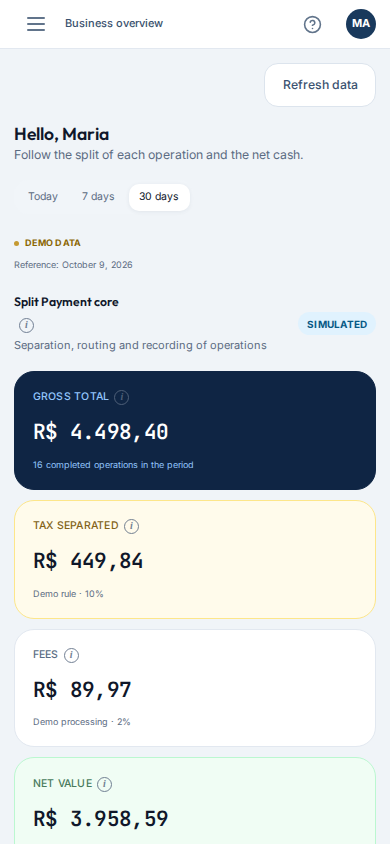

# Planner Comercial — Tax Split

[🇧🇷 Português](README.md) · **🇺🇸 English** · [🇪🇸 Español](README.es.md)

<p align="center"><em>Cash planning so small merchants are not decapitalized by the split payment of Brazil's tax reform.</em></p>

<p align="center"><a href="https://planner-api-tvmg.onrender.com/"></a></p>

<p align="center"><a href="https://planner-api-tvmg.onrender.com/"><b>▶ Open the live site</b></a></p>

Project by **Squad 19** of the **Grow Up 2026.2** Technology Residency (Porto Digital and Faculdade Senac de Pernambuco, Recife, Brazil), built with partner company **Avanade**.

**See it running now:** https://planner-api-tvmg.onrender.com/ (site and API at the same address, on Render; on the free plan, the first visit may take up to 1 minute).

**Test account on the live site** (shared, fictitious data only):

| Email | Password |
|---|---|
| `teste.planner.squad19@example.com` | `Testepl@annersquad19` |

Anyone can use this account, so do not put real data in it. After 5 wrong passwords in a row, access is locked for 15 minutes for everyone. To test without that risk, create your own account under **Entrar → Cadastre-se** (Sign in → Sign up).


## Install and run

**Requirements:** Git, JDK 21, Node.js 20.19+ (or 22.12+), Python 3 and curl. Docker is not needed.

**Linux or macOS, one command** (starts the API with a local database and the website):

```bash
git clone https://github.com/lucasandare490/Avanade.git && cd Avanade && ./scripts/dev.sh
```

**Windows (PowerShell)**, in two terminals, in the project folder:

```powershell
.\scripts\iniciar-backend-local.ps1 -Jdk 'C:\Program Files\Eclipse Adoptium\jdk-21.0.4.7-hotspot'
```

```powershell
npm.cmd --prefix frontend ci; npm.cmd run dev
```

**Demo only, no Java** (fictitious data in the browser):

```bash
cd frontend && npm ci && VITE_MODO_DADOS=demo npm run dev
```

**How to confirm it works**

1. Open http://127.0.0.1:5173: the Planner Comercial start screen appears.
2. Click **Sign in** and then **Sign up** to create an empty store. Or sign in with `gerente1@demo.local` and the password generated in `backend/.local/demo-password`.
3. The API answers `{"status":"UP"}` at http://127.0.0.1:8080/actuator/health.

Use the menu to switch the interface to English or Spanish and the theme to light, dark or system.

## Video pitch

🎬 **Coming soon:** the video pitch (up to 5 minutes) will be published here.

<!-- Quando o vídeo estiver no YouTube (não listado), troque ID_DO_VIDEO pelo código do link (o que vem depois de "v=") e apague a linha "Em breve" acima:
<p align="center"><a href="https://www.youtube.com/watch?v=ID_DO_VIDEO"></a></p>
-->

[Recording script (Portuguese)](documentacao/pitch/ROTEIRO-PITCH.md)

<p align="center">       </p>

## The problem

Brazil's consumption Tax Reform (Constitutional Amendment 132/2023 and Complementary Law 214/2025) creates the IBS and CBS taxes and introduces **split payment**: the tax portion is separated automatically **at the moment the customer pays**, and the merchant receives only the net amount.

Today, the tax money enters the merchant's cash together with the sale and only leaves weeks later, on the tax due date. In between, it works as **working capital**: it pays suppliers, stock and salaries. With split payment, that money no longer comes in. Small and medium merchants lose working capital all at once. That is **decapitalization**. Without planning, a business that sells well can run out of cash to pay its bills.

So the core problem **is not how to pay the tax on each sale**, since split payment already does that by itself. It is **how to keep cash healthy when the tax leaves at the moment of the sale**.

## The solution

**Planner Comercial** helps merchants see decapitalization coming and get ahead of it:

- shows, sale by sale, how much went to tax, how much went to the payment fee and how much **actually entered the cash**;
- calculates actual cash (net inflows minus paid expenses) and weekly cash;
- projects cash for the coming days and warns when the scenario points to a deficit;
- simulates sales before they happen, to understand the impact of each percentage;
- explains the numbers in plain language, with rule-based analysis, no external AI and no changes to values;
- when cash is about to get tight, offers **working capital** from a partner bank or fintech inside the app, with every cost shown before contracting;
- handles the other effects of the tax reform on cash: tracks **IBS/CBS credits from purchases** (including reading the NF-e XML), recalculates the **selling price**, shows how much cash longer **supplier terms** free up, compares **receivables advances** with credit and generates the **accountant package**.

**Real persistence in PostgreSQL. Payments, split and taxes are simulated:** no money is transferred and no tax is paid. Example percentages are not legislation. Working capital already works end to end with simulated partners (a bank and a fintech); to use real money, connect a partner authorized by the Central Bank of Brazil.

## Screens

Screenshots from the demo (fictitious data). Every screen is available in Portuguese, English and Spanish, in light and dark themes.

<table>
<tr><td align="center" valign="top"><br><sub>Entry: theme and language chosen at the top</sub></td><td align="center" valign="top"><br><sub>Dashboard: gross, tax, fee and what actually reaches the cash</sub></td></tr>
<tr><td align="center" valign="top"><br><sub>Cash flow: net inflows, expenses and balance</sub></td><td align="center" valign="top"><br><sub>Sale and split: where each part of the payment went</sub></td></tr>
<tr><td align="center" valign="top"><br><sub>Working capital: decapitalization diagnosis and credit offers</sub></td><td align="center" valign="top"><br><sub>Tax reform and cash: IBS/CBS purchase credits, price, supplier terms, advances and accountant package</sub></td></tr>
<tr><td align="center" valign="top"><br><sub>"i" icon: an explanation for every piece of information</sub></td><td align="center" valign="top"><br><sub>Dark theme</sub></td></tr>
<tr><td align="center" valign="top" colspan="2"><br><sub>Mobile</sub></td></tr>
</table>

## What the system has

| Area | How it works |
|---|---|
| Secure sign-in | 15-minute temporary lock after 5 wrong passwords in a row. Each error shows how many attempts are left. It also has account recovery by email, an eye button to show the password, **Remember me** and **Don't have an account yet? Sign up** |
| Theme | Light, dark or follow the system, on every screen, chosen in the menu |
| Languages | Portuguese, English and Spanish on every screen, chosen in the menu |
| Explanations | An **i** icon next to each piece of information. It shows what it means on mouse hover, with the Tab key or with a tap on mobile |
| Sales and split | Simulated payment, split into tax, fee and net, historical rule and resuming a partial failure |
| Expenses | Recording paid expenses, search and a category suggestion confirmed by the person |
| Cash | Server totals, daily breakdown, weekly cash, manual projection with a deficit warning |
| Reports | Sales, expenses and tax breakdown by period, with full CSV |
| Working capital | Inside the app, without going to the bank. **Decapitalization diagnosis** (tax withheld, 30-day cash shortfall, coverage and recommendation), **bank and fintech offers compared by CET**, responsible lending (blocks installments above 50% of inflows), **cash before and after** over 12 weeks, contracting, installment payment, **early payoff with discount**, 7-day withdrawal, contract summary and immutable history. Simulated partners today; connecting a real partner is one class and a signed webhook. [Specification and integration](documentacao/INTEGRACAO-PARCEIRO-CREDITO.md) (in Portuguese) |
| Tax reform and cash | **IBS/CBS credits from purchases** (field on the expense and **NF-e XML** reading), tax withheld, net tax and accumulated credit; **selling price** with IBS/CBS added on top, credit, fee and margin; **supplier terms** and how much of the cash shortfall they cover; **receivables advance** compared with working capital; **accountant package** in CSV. [Formulas and rules](documentacao/REFORMA-NO-CAIXA.md) (in Portuguese) |
| Android | Kotlin POS client, local and integrated over HTTPS. Testing on a physical device is pending |

## Team and what each person did

### Roles in the squad

- **Thayná Batista da Silva:** Scrum Master; design and prototyping; research; requirements documentation; README in Portuguese, English and Spanish; development and testing of the final delivery.
- **Kássio Lima de Oliveira:** project code and deployment.
- **Lucas André Cardoso de Lima:** front-end code (web and Android) and back-end features up to the partial delivery.
- **Kleysson Teixeira da Cruz Junior:** team organization (Trello) and user interviews.
- **Heitor Sette Couto de Melo:** pitch deck presentation.
- **James Bernardino da Silva Neto:** squad member.

### What each person did

| Person | Role in the squad | Recorded contributions |
|---|---|---|
| **Thayná Batista da Silva** | Scrum Master; design and prototyping; research; requirements documentation; README in Portuguese, English and Spanish; testing | High-fidelity prototype in [Figma](https://www.figma.com/make/tJXFL2o4nYoZnZARUCkBLQ/Planner-Comercial-MVP-Design); research and requirements gathering for Split Pay and Planner Comercial; requirements documentation. In the final delivery: corrected core problem (decapitalization); sign-in with lock, attempts warning, email recovery, eye button, Remember me and Sign up; light, dark and system themes; PT/EN/ES languages; **i** icons with explanations; audit checkers; in-app working capital (diagnosis, offers, contracting, installments, payoff and withdrawal); tax reform and cash (IBS/CBS credits with NF-e reading, selling price, supplier terms, advances and accountant package); site and API in a single deploy on Render, with production updated, and Vercel no longer used; requirements documentation V3; visual README and pitch script; new backend, unit and browser tests |
| **Kássio Lima de Oliveira** | Project code and deployment | Backend–frontend integration with persistence; operation recovery; secure password recovery flow; Supabase setup; deployment on Render (API) and Vercel (website); monitoring and backup routine |
| **Lucas André Cardoso de Lima** | Web and Android front end; back-end and database features | First version of the web dashboard (React and TypeScript) and of the Android app (Kotlin), from the team's prototype; simulated sale flow (enter and review the amount, history, detail with tax, fee and net); expenses, period comparison, projection of inflows and outflows and weekly cash closing. On the back end (Java/Spring and PostgreSQL): store and manager sign-up, editing the business according to permissions, sales, expense and tax reports with CSV, expense category suggestion, the rule in force on the sale date and split recovery without charging again. Documentation of the contracts between site, app and API, with success and failure examples; review of the 516 criteria with evidence and open items; tests, accessibility, small screens and connection failures; database restore check (15 tables); development reports, demo script and data; presenting the interface at mentoring; preparing and testing the hosting package |
| **Kleysson Teixeira da Cruz Junior** | Team organization and user interviews | Organized and split the team's tasks; set up and kept the Trello board up to date, with the development team's tasks; visual value journey/flow and visual navigation map for the development team to work from, together with the requirements documentation; user interviews and support in field research; support in writing the documentation; MVP README review; created and shared the project's [initial repository](https://github.com/Kleyssonteixeirapf/projeto-split-tributario) on GitHub; recorded the activities on Discord; support for general project tasks |
| **Heitor Sette Couto de Melo** | Pitch | Pitch deck presentation |
| **James Bernardino da Silva Neto** | Squad member | — |

Mentor: **Eryson Moreira** (Avanade). Class: GROWUP-SENAC-N2. The authorship of every code change can be checked in the [commit history](https://github.com/lucasandare490/Avanade/commits/main) and in [CHANGELOG.md](CHANGELOG.md).

## Project documents

- [Figma prototype](https://www.figma.com/make/tJXFL2o4nYoZnZARUCkBLQ/Planner-Comercial-MVP-Design) and [design documentation, tokens and screenshots](documentacao/design/README.md)
- [Squad 19 documentation folder](https://drive.google.com/drive/folders/1_4WXflZ5LvJ3yTbEgqiSV5Qw5S6jHoYp?usp=sharing)
- [Split Pay and Planner Comercial analysis and requirements gathering](https://docs.google.com/document/d/1QoIXru-uVBmSDMy6YKjTAkVvk_0Q2kk5_WnfubFtVPU/edit?usp=sharing)
- [Requirements documentation V3, updated 2026-11-25](documentacao/requisitos/V3_Documentacao_de_planejamento_Planner_Comercial.pdf) ([Word](documentacao/requisitos/V3_Documentacao_de_planejamento_Planner_Comercial.docx)); [V3 version on Drive](https://drive.google.com/file/d/1vVnfrVgZK3bq6WkOebF9asDFymMlAvqL/view); [V2 version on Drive](https://docs.google.com/document/d/13OdFEBoY3y_6TPt6pDJQwXycZW9mGdwy/edit?usp=sharing)
- [Final delivery document (PDF, in Portuguese)](documentacao/entrega-final/Entrega_Final_GrowUp_Senac_Squad19_Planner_Comercial_Avanade.pdf)
- [Partial delivery](https://docs.google.com/document/d/16FiTQW6DRE6WRpWBlSeXzVHnP-lr3DfT/edit?usp=sharing)
- [Final delivery record](documentacao/ENTREGA-FINAL-2026-11-18.md) (in Portuguese): what changed, how it was tested and what is pending
- [API contract](backend/docs/API.md) · [Supabase integration](scripts/supabase/README.md) · [Production operation](documentacao/OPERACAO-PRODUCAO.md)

## Tests and audit

| What to test | Command |
|---|---|
| Backend (Java, embedded database) | `cd backend && ./mvnw test` |
| Frontend (unit) | `cd frontend && npm test` |
| Types and build | `cd frontend && npm run build` |
| Browser: sign-in, theme, languages, **i** icons and accessibility (starts the demo by itself) | `cd frontend && npm run test:e2e:entrega` |
| Browser against the real API | with `./scripts/dev.sh` running (use `LOGIN_RATE_LIMIT_PER_MINUTE=300` on the local server, since the suite logs in many times): `cd frontend && npx playwright test` |
| Every interface phrase translated | `node scripts/auditoria/verificar-traducoes.mjs` |
| No AI credit anywhere in the project | `node scripts/auditoria/verificar-sem-credito-ia.mjs` |
| Dark theme in sync with the light theme | `cd frontend && node scripts/gerar-tema-escuro.mjs --verificar` |
| Published site and API up to date | `node scripts/auditoria/site-producao.mjs` and `node scripts/auditoria/api-producao.mjs` |
| Update the test counts in this README (CI rejects outdated numbers) | `npm run testes:contagem`, then commit the READMEs |

The system is auditable: every change has an authored commit, the [CHANGELOG](CHANGELOG.md) summarizes what changed and anyone can run the checkers above.

### Record of all tests

Results measured on <!-- t:data -->2026-11-25<!-- /t -->, in GitHub CI and on Thayná's machine. All passed.

| Suite | What it covers | Result | Where it ran |
|---|---|---|---|
| Backend | <!-- t:backend-classes -->23 classes: `BackendIntegrationTest` (21), `CadastroIntegrationTest` (3), `CenarioCompletoTest` (1), `ConsultaExplicacaoLimitadaTest` (2), `CrashRecoveryTest` (1), `CreditoIntegrationTest` (10), `CreditoWebhookIntegrationTest` (1), `EstabelecimentoIntegrationTest` (2), `InterpretacaoTendenciasTest` (3), `LimiteAcessoCompartilhadoTest` (4), `LoginBloqueioIntegrationTest` (4), `MigrationUpgradeTest` (1), `OperacaoSeguraTest` (2), `OperationExportLimitTest` (1), `PlanejamentoIntegrationTest` (2), `QueryAndCashIntegrationTest` (14), `RecuperacaoSenhaEmailTest` (3), `RecuperacaoSenhaIntegrationTest` (2), `ReformaIntegrationTest` (5), `shared.ApiErrorsTest` (1), `TaxEngineTest` (4), `ValidacaoExplicacaoFinanceiraTest` (2), `VigenciaRegraIntegrationTest` (1)<!-- /t --> | **<!-- t:backend -->90 of 90<!-- /t -->** | GitHub CI (`main`) |
| Frontend, unit | <!-- t:unit-arquivos -->20<!-- /t --> files in `frontend/src`: credit and tax reform calculations, NF-e, API contract, session, screens, languages and **i** icons | **<!-- t:unit -->157 of 157<!-- /t -->** | Local machine |
| Browser on the demo | <!-- t:demo-arquivos -->`entrega-final.spec.ts` (22), `teclado-e-ampliacao.spec.ts` (3)<!-- /t -->: login, recovery, Remember me, working capital, tax reform, theme, languages, **i** icons, WCAG A/AA in both themes, keyboard and zoom | **<!-- t:demo -->25 of 25<!-- /t -->** | Local machine |
| Browser against the real API | <!-- t:api-arquivos -->`acesso-acessibilidade.spec.ts` (3), `cadastro.spec.ts` (1), `caixa-semanal.spec.ts` (1), `credito-integrado.spec.ts` (1), `estados-consulta.spec.ts` (2), `integracao.spec.ts` (6), `login-integrado.spec.ts` (2), `reforma-integrado.spec.ts` (1), `relatorios-acessibilidade.spec.ts` (1), `responsividade.spec.ts` (5)<!-- /t --> | **<!-- t:api -->23 of 23<!-- /t -->** | Local machine, with local API and database |
| Browser on the single address (site served by the API) | `login-integrado`, `credito-integrado` and `reforma-integrado` | **4 of 4** | Local machine |
| Production | site and API at one address, remaining attempts on login, recovery without a session, security headers, database updated (V6 to V13) | **passed** | https://planner-api-tvmg.onrender.com |
| Translations and explanations | 1,145 texts in English and Spanish and 241 explanations in three languages | **complete** | `verificar-traducoes.mjs` |
| Accessibility (axe) | 12 screens, light and dark themes | **0 violations** | inside the demo suite |
| Audit | no AI credit, commit authorship, README in three languages | **passed** | `scripts/auditoria/` |
| GitHub CI | backend, Android, Docker, hosting and site | **all checks** | GitHub Actions |

The numbers in this table are checked by GitHub CI on every change (`scripts/auditoria/contagem-testes.mjs`): if a test is added or removed without updating the README, CI rejects it. Tests that failed and were fixed are listed in the [CHANGELOG](CHANGELOG.md) and in the [final delivery](documentacao/ENTREGA-FINAL-2026-11-18.md) (in Portuguese). `CrashRecoveryTest` depends on timing and can time out on a very busy machine; it passes in CI.

## Security and privacy

- Passwords hashed with BCrypt. The access token is opaque, revocable and expires. The password is never stored in the browser.
- The sign-in lock lives on the server, stores only a hash of the email and answers the same way for registered and unregistered emails, so nobody can find out which accounts exist.
- **Remember me** keeps the token on this device until the session expires. Do not use it on a shared computer.
- The recovery link is valid for 30 minutes and only once, and the token travels in the URL `#` fragment, which never reaches server logs. Sending the email requires SMTP configured on the server (`SPRING_MAIL_HOST`, `SPRING_MAIL_PORT`, `SPRING_MAIL_USERNAME`, `SPRING_MAIL_PASSWORD`, `PASSWORD_RESET_FROM`, `PASSWORD_RESET_LINK_BASE`). Without it, the request is accepted and nothing is sent. Step by step (in Portuguese): [set up the recovery email](documentacao/CONFIGURAR-EMAIL-RECUPERACAO.md). In the local demo, the email is simulated by a link on the screen.
- No password, key or local database goes into the repository (`.env`, `backend/.local` and similar are in `.gitignore`).

## Folders

- `frontend/`: React 19, TypeScript and Vite website. Screens in `src/telas`; theme, languages and explanations in `src/preferencias`.
- `backend/`: Java 21, Spring Boot, PostgreSQL and Flyway API (migrations V1–V12).
- `android-pos/`: Kotlin POS app.
- `scripts/`: local run, Supabase, hosting and `auditoria/`.
- `documentacao/`: status, decisions, operations and history.

## License

© 2026 Squad 19 (Thayná Batista da Silva, Kássio Lima de Oliveira, Lucas André Cardoso de Lima, Kleysson Teixeira da Cruz Junior, Heitor Sette Couto de Melo and James Bernardino da Silva Neto). **All rights reserved.** You may view this repository to evaluate the project; any other use requires written permission. Details in [LICENSE](LICENSE).
