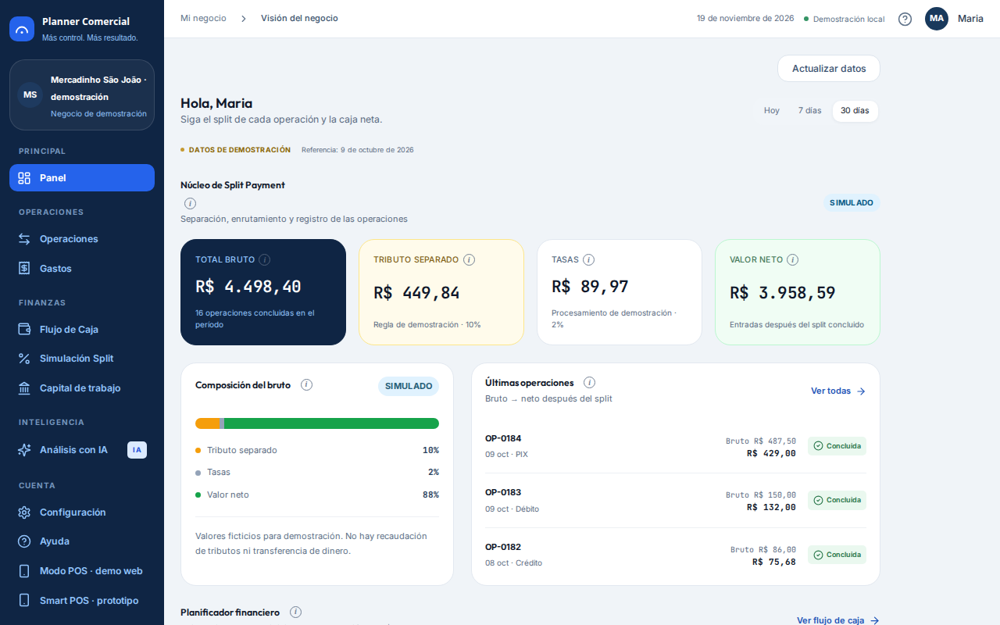
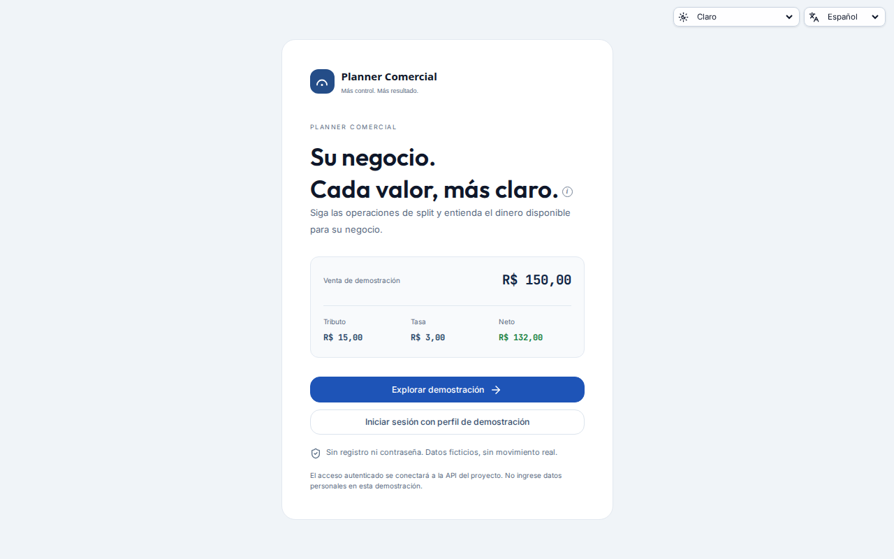
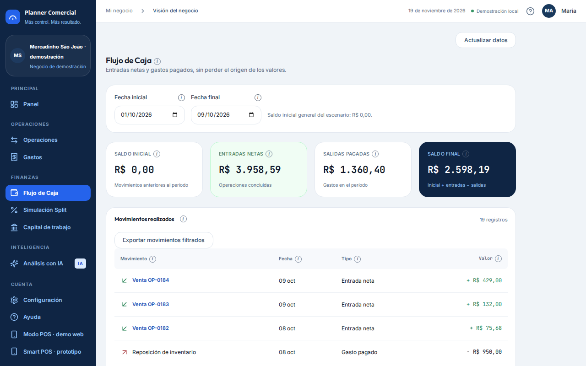
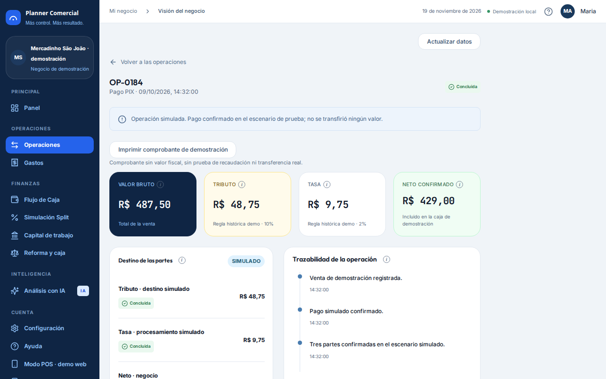
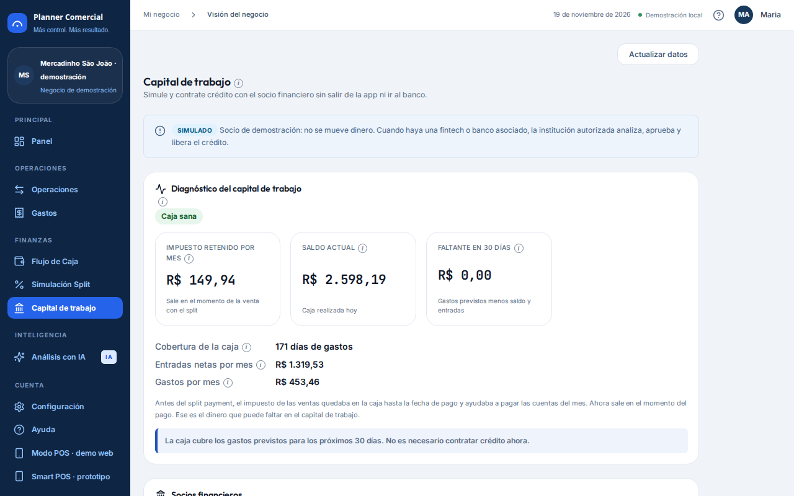
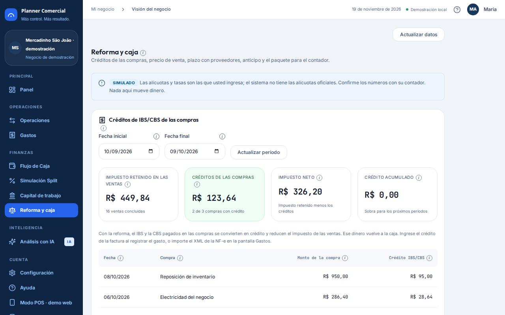
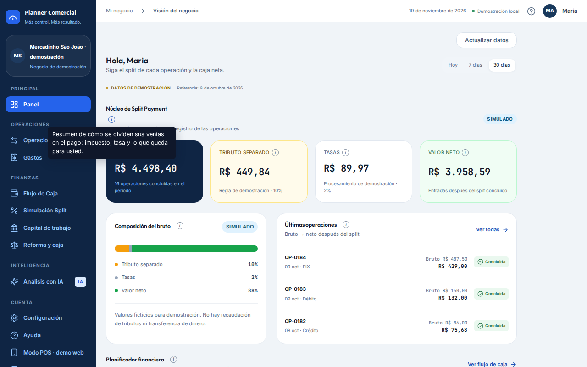
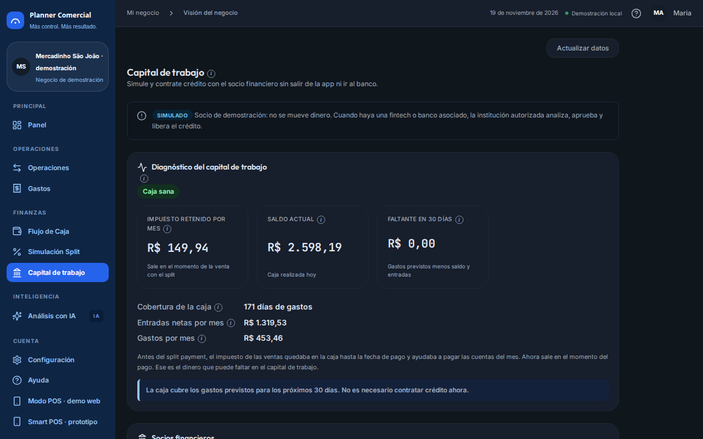
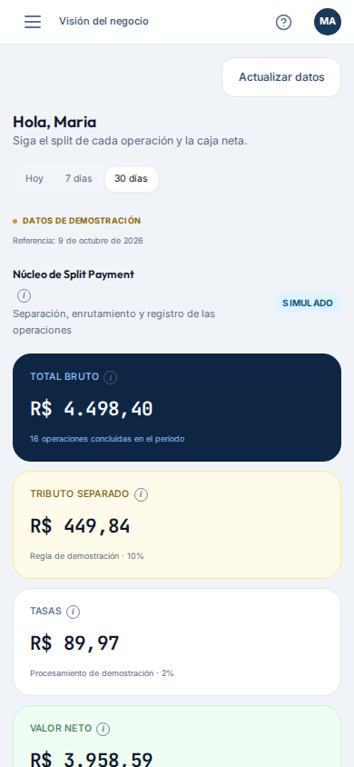

# Planner Comercial — Split Tributario

[🇧🇷 Português](README.md) · [🇺🇸 English](README.en.md) · **🇪🇸 Español**

<p align="center"><em>Planificación de caja para que el pequeño comerciante no se descapitalice con el split payment de la reforma tributaria de Brasil.</em></p>

<p align="center"><a href="https://planner-api-tvmg.onrender.com/"></a></p>

<p align="center"><a href="https://planner-api-tvmg.onrender.com/"><b>▶ Abrir el sitio publicado</b></a></p>

Proyecto del **Squad 19** de la Residencia Tecnológica **Grow Up 2026.2** (Porto Digital y Faculdade Senac de Pernambuco, Recife, Brasil), hecho con la empresa asociada **Avanade**.

**Véalo funcionando ahora:** https://planner-api-tvmg.onrender.com/ (sitio y API en la misma dirección, en Render; en el plan gratuito, el primer acceso puede tardar hasta 1 minuto).

**Cuenta de prueba en el sitio publicado** (compartida, solo con datos ficticios):

| Correo | Contraseña |
|---|---|
| `teste.planner.squad19@example.com` | `Testepl@annersquad19` |

Cualquier persona puede usar esta cuenta, así que no ponga datos reales en ella. Después de 5 contraseñas incorrectas seguidas, el acceso queda bloqueado por 15 minutos para todos. Para probar sin ese riesgo, cree su propia cuenta en **Entrar → Cadastre-se** (Iniciar sesión → Registrarse).


## Instalar y ejecutar

**Requisitos:** Git, JDK 21, Node.js 20.19+ (o 22.12+), Python 3 y curl. No se necesita Docker.

**Linux o macOS, un solo comando** (inicia la API con base de datos local y el sitio):

```bash
git clone https://github.com/lucasandare490/Avanade.git && cd Avanade && ./scripts/dev.sh
```

**Windows (PowerShell)**, en dos terminales, en la carpeta del proyecto:

```powershell
.\scripts\iniciar-backend-local.ps1 -Jdk 'C:\Program Files\Eclipse Adoptium\jdk-21.0.4.7-hotspot'
```

```powershell
npm.cmd --prefix frontend ci; npm.cmd run dev
```

**Solo la demostración, sin Java** (datos ficticios en el navegador):

```bash
cd frontend && npm ci && VITE_MODO_DADOS=demo npm run dev
```

**Cómo confirmar que funcionó**

1. Abra http://127.0.0.1:5173: aparece la pantalla de entrada de Planner Comercial.
2. Haga clic en **Iniciar sesión** y después en **Regístrese** para crear una tienda vacía. O inicie sesión con `gerente1@demo.local` y la contraseña generada en `backend/.local/demo-password`.
3. La API responde `{"status":"UP"}` en http://127.0.0.1:8080/actuator/health.

Use el menú para cambiar la interfaz a español o inglés y el tema a claro, oscuro o del sistema.

## Pitch en video

🎬 **Próximamente:** el video del pitch (hasta 5 minutos) se publicará aquí.

<!-- Quando o vídeo estiver no YouTube (não listado), troque ID_DO_VIDEO pelo código do link (o que vem depois de "v=") e apague a linha "Em breve" acima:
<p align="center"><a href="https://www.youtube.com/watch?v=ID_DO_VIDEO"></a></p>
-->

[Guion de la grabación (en portugués)](documentacao/pitch/ROTEIRO-PITCH.md)

<p align="center">       </p>

## El problema

La Reforma Tributaria del consumo de Brasil (Enmienda Constitucional 132/2023 y Ley Complementaria 214/2025) crea los impuestos IBS y CBS e introduce el **split payment**: la parte del impuesto se separa automáticamente **en el momento en que el cliente paga**, y el comerciante recibe solo el valor neto.

Hoy, el dinero del impuesto entra en la caja junto con la venta y solo sale semanas después, en la fecha de pago del impuesto. En ese intervalo funciona como **capital de trabajo**: paga proveedores, inventario y salarios. Con el split payment, ese dinero deja de entrar. El pequeño y mediano comerciante pierde capital de trabajo de una sola vez. Esa es la **descapitalización**. Sin planificación, un negocio que vende bien puede quedarse sin caja para pagar sus cuentas.

Por lo tanto, el problema central **no es cómo pagar el impuesto de cada venta**, porque el split payment ya lo hace solo. Es **cómo mantener la caja sana cuando el impuesto sale en el momento de la venta**.

## La solución

**Planner Comercial** ayuda al comerciante a ver la descapitalización y anticiparse a ella:

- muestra, venta por venta, cuánto fue al impuesto, cuánto a la tasa del medio de pago y cuánto **entró de verdad en la caja**;
- calcula la caja realizada (entradas netas menos gastos pagados) y la caja por semana;
- proyecta la caja de los próximos días y avisa cuando el escenario indica déficit;
- simula ventas antes de que ocurran, para entender el impacto de cada porcentaje;
- explica los números en lenguaje simple, con análisis por reglas, sin IA externa y sin alterar valores;
- cuando la caja va a quedar ajustada, ofrece **capital de trabajo** de un banco o fintech asociado dentro de la app, con todos los costos a la vista antes de contratar;
- se ocupa de los otros efectos de la reforma en la caja: sigue los **créditos de IBS/CBS de las compras** (incluso leyendo el XML de la NF-e), recalcula el **precio de venta**, muestra cuánta caja libera el **plazo con proveedores**, compara el **anticipo de cobros** con el crédito y genera el **paquete para el contador**.

**Persistencia real en PostgreSQL. Los pagos, el split y los tributos son simulados:** no hay transferencia de dinero ni pago de impuestos. Los porcentajes de ejemplo no son legislación. El capital de trabajo ya funciona de punta a punta con socios simulados (un banco y una fintech); para usar dinero real, basta conectar un socio autorizado por el Banco Central de Brasil.

## Pantallas

Capturas de la demostración (datos ficticios). Todas las pantallas están en portugués, inglés y español, en tema claro y oscuro.

<table>
<tr><td align="center" valign="top"><br><sub>Entrada: tema e idioma elegidos arriba</sub></td><td align="center" valign="top"><br><sub>Panel: bruto, impuesto, tasa y lo que realmente entra en la caja</sub></td></tr>
<tr><td align="center" valign="top"><br><sub>Flujo de caja: entradas netas, gastos y saldo</sub></td><td align="center" valign="top"><br><sub>Venta y split: adónde fue cada parte del pago</sub></td></tr>
<tr><td align="center" valign="top"><br><sub>Capital de trabajo: diagnóstico de la descapitalización y ofertas de crédito</sub></td><td align="center" valign="top"><br><sub>Reforma y caja: créditos de IBS/CBS de las compras, precio, plazo, anticipo y paquete para el contador</sub></td></tr>
<tr><td align="center" valign="top"><br><sub>Ícono i: explicación de cada información</sub></td><td align="center" valign="top"><br><sub>Tema oscuro</sub></td></tr>
<tr><td align="center" valign="top" colspan="2"><br><sub>Celular</sub></td></tr>
</table>

## Qué tiene el sistema

| Área | Cómo funciona |
|---|---|
| Inicio de sesión seguro | Bloqueo temporal de 15 minutos tras 5 contraseñas erróneas seguidas. En cada error se muestra cuántos intentos quedan. También tiene recuperación de cuenta por correo, botón de ojo para ver la contraseña, **Recordarme** y **¿Aún no tiene una cuenta? Regístrese** |
| Tema | Claro, oscuro o según el sistema, en todas las pantallas, elegido en el menú |
| Idiomas | Portugués, inglés y español en todas las pantallas, elegidos en el menú |
| Explicaciones | Un ícono **i** junto a cada dato. Muestra qué significa al pasar el ratón, con la tecla Tab o con un toque en el celular |
| Ventas y split | Pago simulado, división en impuesto, tasa y neto, regla histórica y reanudación de falla parcial |
| Gastos | Registro de gasto pagado, búsqueda y sugerencia de categoría confirmada por la persona |
| Caja | Totales del servidor, composición diaria, caja semanal, proyección manual con aviso de déficit |
| Informes | Ventas, gastos y composición tributaria por período, con CSV completo |
| Capital de trabajo | Dentro de la app, sin ir al banco. **Diagnóstico de la descapitalización** (impuesto retenido, faltante de caja en 30 días, cobertura y recomendación), **ofertas de banco y fintech comparadas por el CET**, crédito responsable (bloquea cuotas por encima del 50% de las entradas), **caja antes y después** en 12 semanas, contratación, pago de cuotas, **liquidación anticipada con descuento**, desistimiento en 7 días, resumen del contrato e historial inmutable. Socios simulados hoy; conectar un socio real es una clase y un webhook firmado. [Especificación e integración](documentacao/INTEGRACAO-PARCEIRO-CREDITO.md) (en portugués) |
| Reforma y caja | **Créditos de IBS/CBS de las compras** (campo en el gasto y lectura del **XML de la NF-e**), impuesto retenido, impuesto neto y crédito acumulado; **precio de venta** con IBS/CBS por fuera, crédito, tasa y margen; **plazo con proveedores** y cuánto cubre del faltante de caja; **anticipo de cobros** comparado con el capital de trabajo; **paquete para el contador** en CSV. [Fórmulas y reglas](documentacao/REFORMA-NO-CAIXA.md) (en portugués) |
| Android | Cliente POS en Kotlin, local e integrado por HTTPS. La prueba en dispositivo físico está pendiente |

## Equipo y qué hizo cada persona

### Roles en el squad

- **Thayná Batista da Silva:** Scrum Master; diseño y prototipado; investigación; documentación de requisitos; README en portugués, inglés y español; desarrollo y pruebas de la entrega final.
- **Kássio Lima de Oliveira:** código del proyecto y despliegue.
- **Lucas André Cardoso de Lima:** código del front-end (web y Android) y funcionalidades del back-end hasta la entrega parcial.
- **Kleysson Teixeira da Cruz Junior:** organización del equipo (Trello) y entrevistas con usuarios.
- **Heitor Sette Couto de Melo:** presentación del pitch deck.
- **James Bernardino da Silva Neto:** integrante del squad.

### Qué hizo cada persona

| Persona | Rol en el squad | Contribuciones registradas |
|---|---|---|
| **Thayná Batista da Silva** | Scrum Master; diseño y prototipado; investigación; documentación de requisitos; README en portugués, inglés y español; pruebas | Prototipo de alta fidelidad en [Figma](https://www.figma.com/make/tJXFL2o4nYoZnZARUCkBLQ/Planner-Comercial-MVP-Design); investigación y levantamiento de requisitos de Split Pay y de Planner Comercial; documentación de requisitos. En la entrega final: corrección del problema central (descapitalización); inicio de sesión con bloqueo, aviso de intentos, recuperación por correo, botón de ojo, Recordarme y Regístrese; temas claro, oscuro y del sistema; idiomas PT/EN/ES; íconos **i** con explicaciones; verificadores de auditoría; capital de trabajo dentro de la app (diagnóstico, ofertas, contratación, cuotas, liquidación y desistimiento); reforma y caja (créditos de IBS/CBS con lectura de la NF-e, precio de venta, plazo con proveedores, anticipo y paquete para el contador); sitio y API en un único despliegue en Render, con la producción actualizada, y fin del uso de Vercel; documentación de requisitos V3; README visual y guion del pitch; nuevas pruebas de backend, unitarias y de navegador |
| **Kássio Lima de Oliveira** | Código del proyecto y despliegue | Integración entre backend y frontend con persistencia; recuperación de operaciones; flujo seguro de recuperación de contraseña; configuración de Supabase; despliegue en Render (API) y Vercel (sitio); monitoreo y rutina de respaldo |
| **Lucas André Cardoso de Lima** | Front-end web y Android; funcionalidades del back-end y de la base de datos | Primera versión del panel web (React y TypeScript) y de la app Android (Kotlin), a partir del prototipo del equipo; flujo de la venta simulada (ingresar y revisar el monto, historial, detalle con impuesto, tasa y neto); gastos, comparación entre períodos, proyección de entradas y salidas y cierre semanal de caja. En el back-end (Java/Spring y PostgreSQL): registro de la tienda y del gerente, edición del negocio según el permiso, informes de ventas, gastos e impuestos con CSV, sugerencia de categorías de gastos, regla vigente en la fecha de la venta y recuperación del split sin cobrar de nuevo. Documentación de los contratos entre sitio, app y API, con ejemplos de éxito y falla; revisión de los 516 criterios con evidencias y pendientes; pruebas, accesibilidad, pantallas pequeñas y fallas de conexión; verificación de la restauración de la base (15 tablas); informes de desarrollo, guion y datos de la demostración; presentación de la interfaz en la mentoría; preparación y prueba del paquete de hosting |
| **Kleysson Teixeira da Cruz Junior** | Organización del equipo y entrevistas con usuarios | Organización y división de las tareas del equipo; estructuración y actualización del tablero de Trello, con las tareas del equipo de desarrollo; recorrido y flujo de valor visual y mapa de navegación visual para que el equipo de desarrollo se basara en ellos, junto con la documentación de requisitos; entrevistas con usuarios y apoyo en la investigación de campo; apoyo en la elaboración de la documentación; revisión del README del MVP; creación y difusión del [repositorio inicial](https://github.com/Kleyssonteixeirapf/projeto-split-tributario) del proyecto en GitHub; registro de las actividades en Discord; apoyo en las tareas generales del proyecto |
| **Heitor Sette Couto de Melo** | Pitch | Presentación del pitch deck |
| **James Bernardino da Silva Neto** | Integrante del squad | — |

Mentor: **Eryson Moreira** (Avanade). Grupo: GROWUP-SENAC-N2. La autoría de cada cambio en el código puede verificarse en el [historial de commits](https://github.com/lucasandare490/Avanade/commits/main) y en [CHANGELOG.md](CHANGELOG.md).

## Documentos del proyecto

- [Prototipo en Figma](https://www.figma.com/make/tJXFL2o4nYoZnZARUCkBLQ/Planner-Comercial-MVP-Design) y [documentación de diseño, tokens y capturas](documentacao/design/README.md)
- [Carpeta de documentación del Squad 19](https://drive.google.com/drive/folders/1_4WXflZ5LvJ3yTbEgqiSV5Qw5S6jHoYp?usp=sharing)
- [Análisis y levantamiento de requisitos de Split Pay y Planner Comercial](https://docs.google.com/document/d/1QoIXru-uVBmSDMy6YKjTAkVvk_0Q2kk5_WnfubFtVPU/edit?usp=sharing)
- [Documentación de requisitos V3, actualizada el 25/11/2026](documentacao/requisitos/V3_Documentacao_de_planejamento_Planner_Comercial.pdf) ([Word](documentacao/requisitos/V3_Documentacao_de_planejamento_Planner_Comercial.docx)); [versión V3 en Drive](https://drive.google.com/file/d/1vVnfrVgZK3bq6WkOebF9asDFymMlAvqL/view); [versión V2 en Drive](https://docs.google.com/document/d/13OdFEBoY3y_6TPt6pDJQwXycZW9mGdwy/edit?usp=sharing)
- [Documento de la entrega final (PDF, en portugués)](documentacao/entrega-final/Entrega_Final_GrowUp_Senac_Squad19_Planner_Comercial_Avanade.pdf)
- [Entrega parcial](https://docs.google.com/document/d/16FiTQW6DRE6WRpWBlSeXzVHnP-lr3DfT/edit?usp=sharing)
- [Registro de la entrega final](documentacao/ENTREGA-FINAL-2026-11-18.md) (en portugués): qué cambió, cómo se probó y qué quedó pendiente
- [Contrato de la API](backend/docs/API.md) · [Integración con Supabase](scripts/supabase/README.md) · [Operación en producción](documentacao/OPERACAO-PRODUCAO.md)

## Pruebas y auditoría

| Qué probar | Comando |
|---|---|
| Backend (Java, base de datos embebida) | `cd backend && ./mvnw test` |
| Frontend (unitarias) | `cd frontend && npm test` |
| Tipos y build | `cd frontend && npm run build` |
| Navegador: inicio de sesión, tema, idiomas, íconos **i** y accesibilidad (inicia la demostración solo) | `cd frontend && npm run test:e2e:entrega` |
| Navegador contra la API real | con `./scripts/dev.sh` en ejecución (use `LOGIN_RATE_LIMIT_PER_MINUTE=300` en el servidor local, porque la batería hace muchos inicios de sesión): `cd frontend && npx playwright test` |
| Todas las frases de la interfaz traducidas | `node scripts/auditoria/verificar-traducoes.mjs` |
| Ningún crédito de IA en el proyecto | `node scripts/auditoria/verificar-sem-credito-ia.mjs` |
| Tema oscuro al día con el tema claro | `cd frontend && node scripts/gerar-tema-escuro.mjs --verificar` |
| Sitio y API publicados actualizados | `node scripts/auditoria/site-producao.mjs` y `node scripts/auditoria/api-producao.mjs` |
| Actualizar el conteo de pruebas de este README (el CI rechaza números desactualizados) | `npm run testes:contagem` y luego commit de los README |

El sistema es auditable: cada cambio tiene un commit con autoría, el [CHANGELOG](CHANGELOG.md) resume lo que cambió y cualquier persona puede ejecutar los verificadores de arriba.

### Registro de todas las pruebas

Resultados medidos el <!-- t:data -->25/11/2026<!-- /t -->, en el CI de GitHub y en la máquina de Thayná. Todas pasaron.

| Batería | Qué cubre | Resultado | Dónde se ejecutó |
|---|---|---|---|
| Backend | <!-- t:backend-classes -->23 clases: `BackendIntegrationTest` (21), `CadastroIntegrationTest` (3), `CenarioCompletoTest` (1), `ConsultaExplicacaoLimitadaTest` (2), `CrashRecoveryTest` (1), `CreditoIntegrationTest` (10), `CreditoWebhookIntegrationTest` (1), `EstabelecimentoIntegrationTest` (2), `InterpretacaoTendenciasTest` (3), `LimiteAcessoCompartilhadoTest` (4), `LoginBloqueioIntegrationTest` (4), `MigrationUpgradeTest` (1), `OperacaoSeguraTest` (2), `OperationExportLimitTest` (1), `PlanejamentoIntegrationTest` (2), `QueryAndCashIntegrationTest` (14), `RecuperacaoSenhaEmailTest` (3), `RecuperacaoSenhaIntegrationTest` (2), `ReformaIntegrationTest` (5), `shared.ApiErrorsTest` (1), `TaxEngineTest` (4), `ValidacaoExplicacaoFinanceiraTest` (2), `VigenciaRegraIntegrationTest` (1)<!-- /t --> | **<!-- t:backend -->90 de 90<!-- /t -->** | CI de GitHub (`main`) |
| Frontend, unitarias | <!-- t:unit-arquivos -->20<!-- /t --> archivos en `frontend/src`: cálculos del crédito y de la reforma, NF-e, contrato de la API, sesión, pantallas, idiomas e íconos **i** | **<!-- t:unit -->157 de 157<!-- /t -->** | Máquina local |
| Navegador en la demostración | <!-- t:demo-arquivos -->`entrega-final.spec.ts` (22), `teclado-e-ampliacao.spec.ts` (3)<!-- /t -->: inicio de sesión, recuperación, Recordarme, capital de trabajo, reforma y caja, tema, idiomas, íconos **i**, WCAG A/AA en los dos temas, teclado y ampliación | **<!-- t:demo -->25 de 25<!-- /t -->** | Máquina local |
| Navegador contra la API real | <!-- t:api-arquivos -->`acesso-acessibilidade.spec.ts` (3), `cadastro.spec.ts` (1), `caixa-semanal.spec.ts` (1), `credito-integrado.spec.ts` (1), `estados-consulta.spec.ts` (2), `integracao.spec.ts` (6), `login-integrado.spec.ts` (2), `reforma-integrado.spec.ts` (1), `relatorios-acessibilidade.spec.ts` (1), `responsividade.spec.ts` (5)<!-- /t --> | **<!-- t:api -->23 de 23<!-- /t -->** | Máquina local, con la API y la base locales |
| Navegador en la dirección única (sitio servido por la API) | `login-integrado`, `credito-integrado` y `reforma-integrado` | **4 de 4** | Máquina local |
| Producción | sitio y API en la misma dirección, intentos restantes en el inicio de sesión, recuperación sin sesión, encabezados de seguridad, base actualizada (V6 a V13) | **aprobado** | https://planner-api-tvmg.onrender.com |
| Traducciones y explicaciones | 1.145 textos en inglés y español y 241 explicaciones en tres idiomas | **completas** | `verificar-traducoes.mjs` |
| Accesibilidad (axe) | 12 pantallas, temas claro y oscuro | **0 violaciones** | dentro de la batería de la demostración |
| Auditoría | ningún crédito de IA, autoría de los commits, README en tres idiomas | **aprobada** | `scripts/auditoria/` |
| CI de GitHub | backend, Android, Docker, hosting y sitio | **todas las verificaciones** | GitHub Actions |

Los números de esta tabla los verifica el CI de GitHub en cada cambio (`scripts/auditoria/contagem-testes.mjs`): si se agrega o quita una prueba sin actualizar el README, el CI lo rechaza. Las pruebas que fallaron y se corrigieron están en el [CHANGELOG](CHANGELOG.md) y en la [entrega final](documentacao/ENTREGA-FINAL-2026-11-18.md) (en portugués). `CrashRecoveryTest` depende del tiempo y puede agotar el plazo en una máquina muy cargada; en el CI pasa.

## Seguridad y privacidad

- Contraseñas con BCrypt. El token de acceso es opaco, revocable y expira. La contraseña nunca se guarda en el navegador.
- El bloqueo de inicio de sesión está en el servidor, guarda solo el hash del correo y responde igual para correos registrados y no registrados, así nadie descubre qué cuentas existen.
- **Recordarme** guarda el token en este dispositivo hasta que la sesión expire. No lo use en una computadora compartida.
- El enlace de recuperación vale por 30 minutos y una sola vez, y el token viaja en el fragmento `#` de la URL, que no llega a los registros del servidor. El envío del correo requiere SMTP configurado en el servidor (`SPRING_MAIL_HOST`, `SPRING_MAIL_PORT`, `SPRING_MAIL_USERNAME`, `SPRING_MAIL_PASSWORD`, `PASSWORD_RESET_FROM`, `PASSWORD_RESET_LINK_BASE`). Sin eso, la solicitud se acepta y no se envía nada. Paso a paso (en portugués): [configurar el correo de recuperación](documentacao/CONFIGURAR-EMAIL-RECUPERACAO.md). En la demostración local, el correo se simula con un enlace en la pantalla.
- Ninguna contraseña, clave ni base de datos local entra en el repositorio (`.env`, `backend/.local` y similares están en `.gitignore`).

## Carpetas

- `frontend/`: sitio en React 19, TypeScript y Vite. Pantallas en `src/telas`; tema, idiomas y explicaciones en `src/preferencias`.
- `backend/`: API en Java 21, Spring Boot, PostgreSQL y Flyway (migrations V1–V12).
- `android-pos/`: aplicación POS en Kotlin.
- `scripts/`: ejecución local, Supabase, hosting y `auditoria/`.
- `documentacao/`: estado, decisiones, operación e historial.

## Licencia

© 2026 Squad 19 (Thayná Batista da Silva, Kássio Lima de Oliveira, Lucas André Cardoso de Lima, Kleysson Teixeira da Cruz Junior, Heitor Sette Couto de Melo y James Bernardino da Silva Neto). **Todos los derechos reservados.** Se puede ver este repositorio para evaluar el proyecto; cualquier otro uso requiere autorización por escrito. Detalles en [LICENSE](LICENSE).
