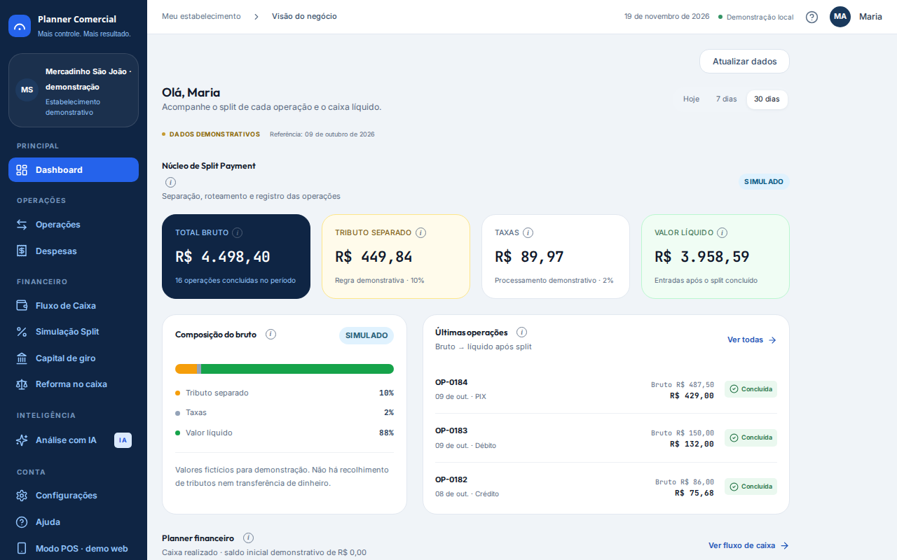
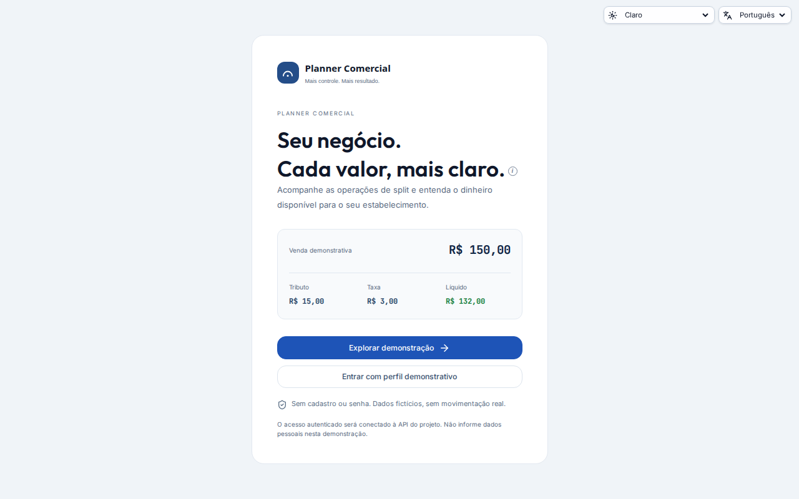
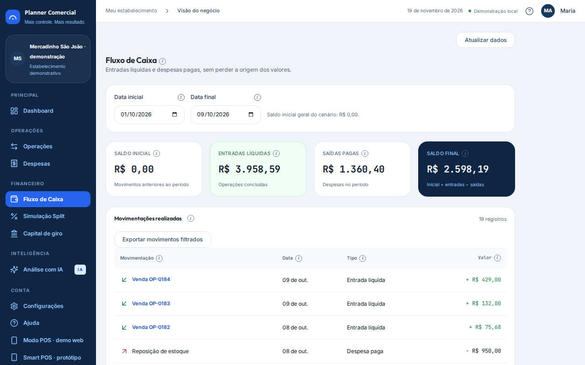
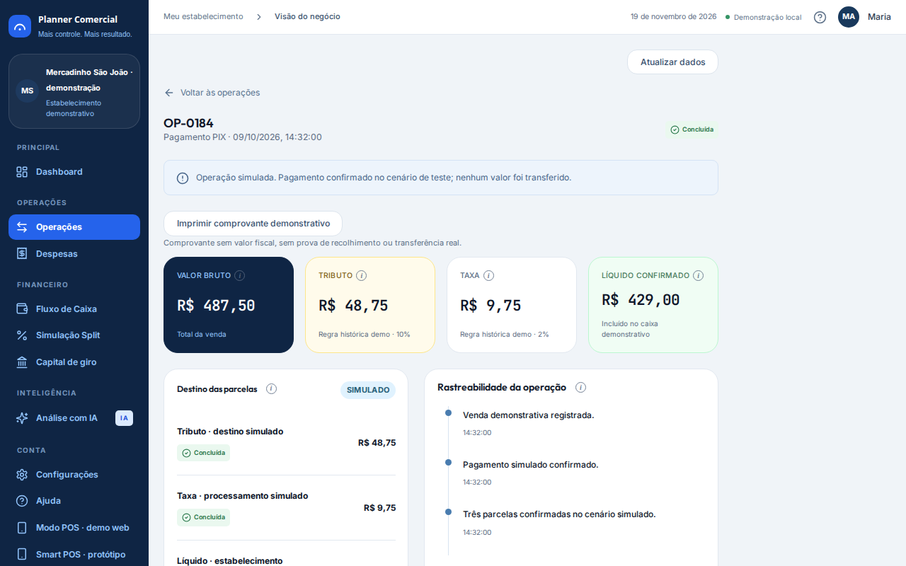
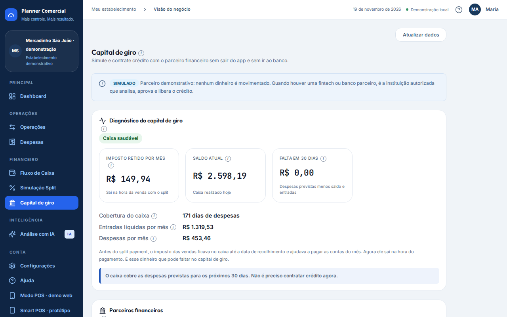
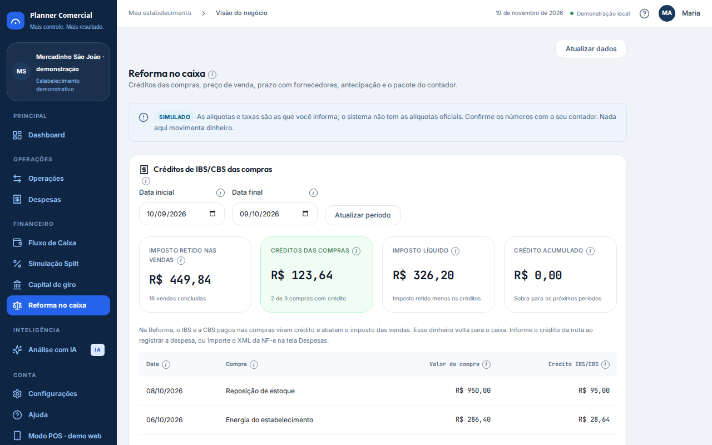
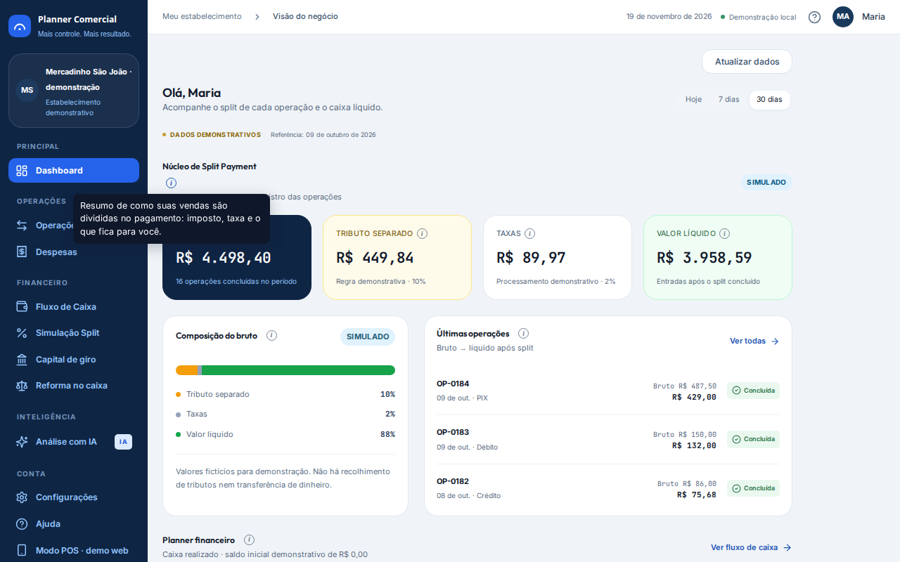
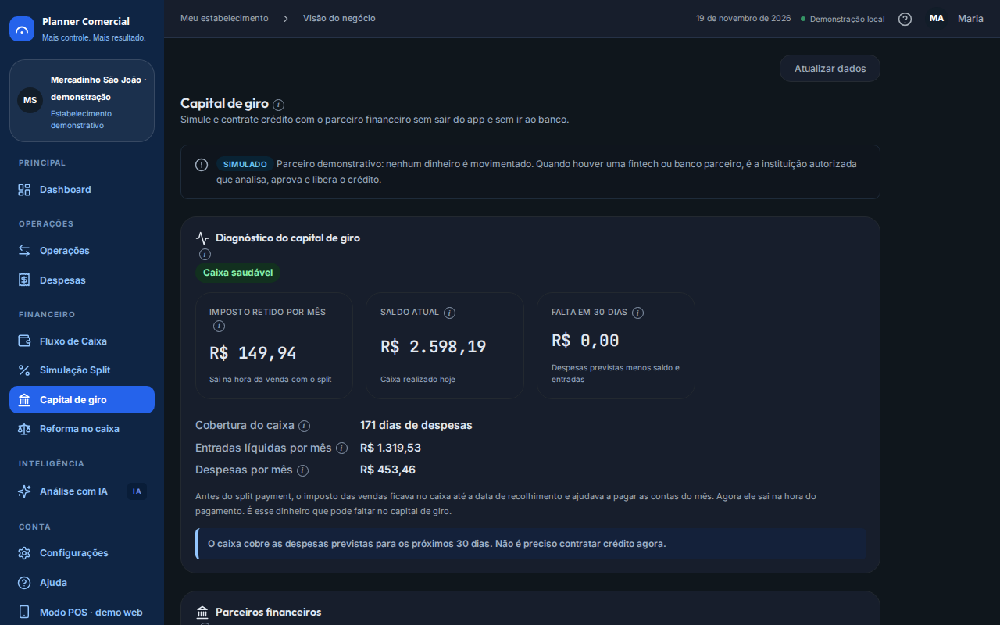
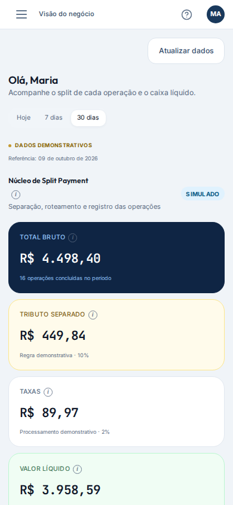

# Planner Comercial — Split Tributário

**🇧🇷 Português** · [🇺🇸 English](README.en.md) · [🇪🇸 Español](README.es.md)

<p align="center"><em>Planejamento de caixa para o pequeno comerciante não se descapitalizar com o split payment da Reforma Tributária.</em></p>

<p align="center"><a href="https://planner-api-tvmg.onrender.com/"></a></p>

<p align="center"><a href="https://planner-api-tvmg.onrender.com/"><b>▶ Abrir o site publicado</b></a></p>

Projeto da **Squad 19** da Residência Tecnológica **Grow Up 2026.2** (Porto Digital e Faculdade Senac de Pernambuco, Recife-PE), feito com a empresa parceira **Avanade**.

**Ver funcionando agora:** https://planner-api-tvmg.onrender.com/ (site e API no mesmo endereço, no Render; no plano gratuito, o primeiro acesso pode levar até 1 minuto).

**Conta de teste no site publicado** (compartilhada, só com dados fictícios):

| E-mail | Senha |
|---|---|
| `teste.planner.squad19@example.com` | `Testepl@annersquad19` |

Qualquer pessoa pode usar essa conta, então não coloque dados reais nela. Depois de 5 senhas erradas seguidas, o acesso fica bloqueado por 15 minutos para todo mundo. Para testar sem esse risco, crie a sua própria conta em **Entrar → Cadastre-se**.


## Instalar e rodar

**Requisitos:** Git, JDK 21, Node.js 20.19+ (ou 22.12+), Python 3 e curl. Docker não é necessário.

**Linux ou macOS, um comando** (sobe a API com banco local e o site):

```bash
git clone https://github.com/lucasandare490/Avanade.git && cd Avanade && ./scripts/dev.sh
```

**Windows (PowerShell)**, em dois terminais, na pasta do projeto:

```powershell
.\scripts\iniciar-backend-local.ps1 -Jdk 'C:\Program Files\Eclipse Adoptium\jdk-21.0.4.7-hotspot'
```

```powershell
npm.cmd --prefix frontend ci; npm.cmd run dev
```

**Só a demonstração, sem Java** (dados fictícios no navegador):

```bash
cd frontend && npm ci && VITE_MODO_DADOS=demo npm run dev
```

**Como confirmar que funcionou**

1. Abra http://127.0.0.1:5173: aparece a tela de entrada do Planner Comercial.
2. Clique em **Entrar** e depois em **Cadastre-se** para criar uma loja vazia. Ou entre com `gerente1@demo.local` e a senha gerada em `backend/.local/demo-password`.
3. A API responde `{"status":"UP"}` em http://127.0.0.1:8080/actuator/health.

## Pitch em vídeo

🎬 **Em breve:** o vídeo do pitch (até 5 minutos) será publicado aqui.

<!-- Quando o vídeo estiver no YouTube (não listado), troque ID_DO_VIDEO pelo código do link (o que vem depois de "v=") e apague a linha "Em breve" acima:
<p align="center"><a href="https://www.youtube.com/watch?v=ID_DO_VIDEO"></a></p>
-->

[Roteiro da gravação](documentacao/pitch/ROTEIRO-PITCH.md)

<p align="center">       </p>

## O problema

A Reforma Tributária do consumo (Emenda Constitucional 132/2023 e Lei Complementar 214/2025) cria o IBS e a CBS e prevê o **split payment**. Com ele, a parte do imposto é separada automaticamente **no momento em que o cliente paga**, e o comerciante recebe só o valor líquido.

Hoje, o dinheiro do imposto entra no caixa junto com a venda e só sai semanas depois, na data de recolhimento. Nesse intervalo, ele funciona como **capital de giro**: paga fornecedor, estoque e salários. Com o split payment, esse dinheiro deixa de entrar. O pequeno e médio comerciante perde capital de giro de uma vez. Essa é a **descapitalização**. Sem planejamento, quem vende bem pode ficar sem caixa para pagar as contas.

O problema central, portanto, **não é como recolher o imposto de cada venda**, porque o split payment já faz isso sozinho. É **como manter o caixa saudável quando o imposto sai na hora da venda**.

## A solução

O **Planner Comercial** ajuda o comerciante a enxergar e a se antecipar à descapitalização:

- mostra, venda a venda, quanto foi para imposto, quanto foi para a taxa do meio de pagamento e quanto **de fato entrou no caixa**;
- calcula o caixa realizado (entradas líquidas menos despesas pagas) e o caixa por semana;
- projeta o caixa dos próximos dias e avisa quando o cenário indica déficit;
- simula vendas antes de acontecerem, para entender o impacto de cada percentual;
- explica os números em linguagem simples, com análise por regras, sem IA externa e sem alterar valores;
- quando o caixa vai apertar, oferece **capital de giro** de um banco ou fintech parceira dentro do próprio app, com todos os custos à vista antes de contratar;
- cuida dos outros efeitos da Reforma no caixa: acompanha os **créditos de IBS/CBS das compras** (inclusive lendo o XML da NF-e), recalcula o **preço de venda**, mostra quanto o **prazo com fornecedores** libera de caixa, compara a **antecipação de recebíveis** com o crédito e gera o **pacote do contador**.

**Persistência real em PostgreSQL. Pagamentos, split e tributos são simulados:** não há transferência de dinheiro nem recolhimento fiscal. Percentuais de exemplo não são legislação. O capital de giro já funciona de ponta a ponta com parceiros simulados (banco e fintech); para usar dinheiro de verdade, basta ligar um parceiro autorizado pelo Banco Central.

## Telas

Prints da demonstração (dados fictícios). Todas as telas existem em português, inglês e espanhol, nos temas claro e escuro.

<table>
<tr><td align="center" valign="top"><br><sub>Entrada: tema e idioma escolhidos no canto superior</sub></td><td align="center" valign="top"><br><sub>Painel: bruto, imposto, taxa e o que de fato entra no caixa</sub></td></tr>
<tr><td align="center" valign="top"><br><sub>Fluxo de caixa: entradas líquidas, despesas e saldo</sub></td><td align="center" valign="top"><br><sub>Venda e split: para onde foi cada parte do pagamento</sub></td></tr>
<tr><td align="center" valign="top"><br><sub>Capital de giro: diagnóstico da descapitalização e ofertas de crédito</sub></td><td align="center" valign="top"><br><sub>Reforma no caixa: créditos de IBS/CBS das compras, preço, prazo, antecipação e pacote do contador</sub></td></tr>
<tr><td align="center" valign="top"><br><sub>Ícone i: explicação de cada informação</sub></td><td align="center" valign="top"><br><sub>Tema escuro</sub></td></tr>
<tr><td align="center" valign="top" colspan="2"><br><sub>Celular</sub></td></tr>
</table>

## O que o sistema tem

| Área | Como funciona |
|---|---|
| Login seguro | Bloqueio temporário de 15 minutos após 5 senhas erradas seguidas. A cada erro aparece quantas tentativas restam. Também tem recuperação de conta por e-mail, botão de olho para ver a senha, **Lembrar de mim** e **Ainda não tem uma conta? Cadastre-se** |
| Tema | Claro, escuro ou seguir o sistema, em todas as telas, escolhido no menu |
| Idiomas | Português, inglês e espanhol em todas as telas, escolhidos no menu |
| Explicações | Ícone **i** ao lado de cada informação. Mostra o que ela significa ao passar o mouse, com a tecla Tab ou com um toque no celular |
| Vendas e split | Pagamento simulado, divisão em imposto, taxa e líquido, regra histórica e retomada de falha parcial |
| Despesas | Registro de despesa paga, busca e sugestão de categoria confirmada pela pessoa |
| Caixa | Agregados do servidor, composição diária, caixa semanal, projeção manual com aviso de déficit |
| Relatórios | Vendas, despesas e composição tributária por período, com CSV completo |
| Capital de giro | Dentro do app, sem ir ao banco. **Diagnóstico da descapitalização** (imposto retido, falta de caixa em 30 dias, cobertura e recomendação), **ofertas de banco e fintech comparadas pelo CET**, crédito responsável (bloqueia parcela acima de 50% das entradas), **antes e depois do caixa** em 12 semanas, contratação, pagamento de parcela, **quitação antecipada com desconto**, desistência em 7 dias, resumo do contrato e histórico imutável. Parceiros simulados hoje; ligar um parceiro real é uma classe e um webhook assinado. [Especificação e integração](documentacao/INTEGRACAO-PARCEIRO-CREDITO.md) |
| Reforma no caixa | **Créditos de IBS/CBS das compras** (campo na despesa e leitura do **XML da NF-e**), imposto retido, imposto líquido e crédito acumulado; **preço de venda** com IBS/CBS por fora, crédito, taxa e margem; **prazo com fornecedores** e quanto ele cobre da falta de caixa; **antecipação de recebíveis** comparada com o capital de giro; **pacote do contador** em CSV. [Fórmulas e regras](documentacao/REFORMA-NO-CAIXA.md) |
| Android | Cliente Kotlin (POS) local e integrado por HTTPS. A homologação em aparelho físico está pendente |

## Equipe e o que cada pessoa fez

### Papéis na squad

- **Thayná Batista da Silva:** Scrum Master; design e prototipação; pesquisa; documentação de requisitos; README em português, inglês e espanhol; desenvolvimento e testes da entrega final.
- **Kássio Lima de Oliveira:** desenvolvimento do back-end e do banco de dados, deploy do projeto e participação nas validações do front-end.
- **Lucas André Cardoso de Lima:** código do front-end (web e Android) e funcionalidades do back-end até a entrega parcial.
- **Kleysson Teixeira da Cruz Junior:** organização da equipe (Trello) e entrevistas com pessoas usuárias.
- **Heitor Sette Couto de Melo:** apresentação do pitch deck.
- **James Bernardino da Silva Neto:** integrante da squad.

### O que cada pessoa fez

| Pessoa | Papel na squad | Contribuições registradas |
|---|---|---|
| **Thayná Batista da Silva** | Scrum Master; design e prototipação; pesquisa; documentação de requisitos; README em português, inglês e espanhol; testes | Protótipo de alta fidelidade no [Figma](https://www.figma.com/make/tJXFL2o4nYoZnZARUCkBLQ/Planner-Comercial-MVP-Design); pesquisa e levantamento de requisitos do Split Pay e do Planner Comercial; documentação de requisitos. Na entrega final: correção do problema central (descapitalização); login com bloqueio, aviso de tentativas, recuperação por e-mail, botão de olho, Lembrar de mim e Cadastre-se; temas claro, escuro e do sistema; idiomas PT/EN/ES; ícones **i** com explicações; verificadores de auditoria; capital de giro dentro do app (diagnóstico, ofertas, contratação, parcelas, quitação e desistência); Reforma no caixa (créditos de IBS/CBS com leitura da NF-e, preço de venda, prazo com fornecedores, antecipação e pacote do contador); site e API num único deploy no Render, com a produção atualizada, e fim do uso da Vercel; documentação de requisitos V3; README visual e roteiro do pitch; testes novos de backend, unitários e de navegador |
| **Kássio Lima de Oliveira** | Back-end, banco de dados e deploy | Desenvolvimento do back-end e do banco de dados; deploy do projeto; participação nas validações do front-end; integração entre backend e frontend com persistência; recuperação de operações; fluxo seguro de recuperação de senha; configuração do Supabase; deploy no Render (API) e na Vercel (site); monitoramento e rotina de backup |
| **Lucas André Cardoso de Lima** | Front-end web e Android; funcionalidades do back-end e do banco | Primeira versão do painel web (React e TypeScript) e do aplicativo Android (Kotlin), a partir do protótipo da equipe; fluxo da venda simulada (informar e revisar o valor, histórico, detalhe com tributo, taxa e líquido); despesas, comparação entre períodos, projeção de entradas e saídas e fechamento semanal do caixa. No back-end (Java/Spring e PostgreSQL): cadastro da loja e do gerente, edição do estabelecimento conforme a permissão, relatórios de vendas, despesas e tributos com CSV, sugestão de categorias de despesas, regra vigente na data da venda e recuperação do split sem cobrar de novo. Documentação dos contratos entre site, aplicativo e API, com exemplos de sucesso e falha; revisão dos 516 critérios com evidências e pendências; testes, acessibilidade, telas menores e falhas de conexão; verificação da restauração do banco (15 tabelas); relatórios de desenvolvimento, roteiro e dados da demonstração; apresentação da interface na mentoria; preparação e teste do pacote de hospedagem |
| **Kleysson Teixeira da Cruz Junior** | Organização da equipe e entrevistas com pessoas usuárias | Organização e divisão das demandas da equipe; estruturação e atualização do quadro no Trello, com as demandas da equipe de desenvolvimento; jornada e fluxo de valor visual e mapa de navegação visual para a equipe de desenvolvimento se basear, junto com a documentação de requisitos; entrevistas com usuários e auxílio na pesquisa de campo; auxílio na elaboração da documentação; revisão do README do MVP; criação e compartilhamento do [repositório inicial](https://github.com/Kleyssonteixeirapf/projeto-split-tributario) do projeto no GitHub; registro das atividades no Discord; suporte nas demandas gerais do projeto |
| **Heitor Sette Couto de Melo** | Pitch | Apresentação do pitch deck |
| **James Bernardino da Silva Neto** | Integrante da squad | — |

Mentor: **Eryson Moreira** (Avanade). Turma: GROWUP-SENAC-N2. A autoria de cada mudança no código pode ser conferida no [histórico de commits](https://github.com/lucasandare490/Avanade/commits/main) e em [CHANGELOG.md](CHANGELOG.md).

## Documentos do projeto

- [Protótipo no Figma](https://www.figma.com/make/tJXFL2o4nYoZnZARUCkBLQ/Planner-Comercial-MVP-Design) e [documentação de design, tokens e capturas](documentacao/design/README.md)
- [Pasta de documentação da Squad 19](https://drive.google.com/drive/folders/1_4WXflZ5LvJ3yTbEgqiSV5Qw5S6jHoYp?usp=sharing)
- [Análise e levantamento de requisitos do Split Pay e do Planner Comercial](https://docs.google.com/document/d/1QoIXru-uVBmSDMy6YKjTAkVvk_0Q2kk5_WnfubFtVPU/edit?usp=sharing)
- [Documentação de requisitos V3, atualizada em 25/11/2026](documentacao/requisitos/V3_Documentacao_de_planejamento_Planner_Comercial.pdf) ([Word](documentacao/requisitos/V3_Documentacao_de_planejamento_Planner_Comercial.docx)); [versão V3 no Drive](https://drive.google.com/file/d/1aOXizhlhLneBQTpqpoFtR3Qm6ltHIdn3/view); [versão V2 no Drive](https://docs.google.com/document/d/13OdFEBoY3y_6TPt6pDJQwXycZW9mGdwy/edit?usp=sharing)
- [Documento da entrega final (PDF)](documentacao/entrega-final/Entrega_Final_GrowUp_Senac_Squad19_Planner_Comercial_Avanade.pdf) · [DOCX](documentacao/entrega-final/Entrega_Final_GrowUp_Senac_Squad19_Planner_Comercial_Avanade.docx)
- [Entrega parcial](https://docs.google.com/document/d/16FiTQW6DRE6WRpWBlSeXzVHnP-lr3DfT/edit?usp=sharing)
- [Registro da entrega final](documentacao/ENTREGA-FINAL-2026-11-18.md): o que mudou, como foi testado e o que ficou pendente
- [Contrato da API](backend/docs/API.md) · [Integração com Supabase](scripts/supabase/README.md) · [Operação em produção](documentacao/OPERACAO-PRODUCAO.md)

## Testes e auditoria

| O que testar | Comando |
|---|---|
| Backend (Java, banco embutido) | `cd backend && ./mvnw test` |
| Frontend (unitários) | `cd frontend && npm test` |
| Tipos e build | `cd frontend && npm run build` |
| Navegador: login, tema, idiomas, ícones **i** e acessibilidade (sobe a demonstração sozinho) | `cd frontend && npm run test:e2e:entrega` |
| Navegador contra a API real | com `./scripts/dev.sh` rodando (use `LOGIN_RATE_LIMIT_PER_MINUTE=300` no servidor local, porque a bateria faz muitos logins): `cd frontend && npx playwright test` |
| Toda frase da interface traduzida | `node scripts/auditoria/verificar-traducoes.mjs` |
| Nenhum crédito de IA no projeto | `node scripts/auditoria/verificar-sem-credito-ia.mjs` |
| Tema escuro em dia com o tema claro | `cd frontend && node scripts/gerar-tema-escuro.mjs --verificar` |
| Site e API publicados atualizados | `node scripts/auditoria/site-producao.mjs` e `node scripts/auditoria/api-producao.mjs` |
| Atualizar a contagem de testes deste README (o CI recusa número desatualizado) | `npm run testes:contagem` e depois commit dos READMEs |

Os resultados da entrega final estão em [documentacao/ENTREGA-FINAL-2026-11-18.md](documentacao/ENTREGA-FINAL-2026-11-18.md). O sistema é auditável: cada mudança tem um commit com autoria, o [CHANGELOG](CHANGELOG.md) resume o que mudou e os verificadores acima podem ser rodados por qualquer pessoa.

### Registro de todos os testes

Resultados medidos em <!-- t:data -->25/11/2026<!-- /t -->, no CI do GitHub e na máquina da Thayná. Todos passaram.

| Bateria | O que cobre | Resultado | Onde rodou |
|---|---|---|---|
| Backend | <!-- t:backend-classes -->23 classes: `BackendIntegrationTest` (21), `CadastroIntegrationTest` (3), `CenarioCompletoTest` (1), `ConsultaExplicacaoLimitadaTest` (2), `CrashRecoveryTest` (1), `CreditoIntegrationTest` (10), `CreditoWebhookIntegrationTest` (1), `EstabelecimentoIntegrationTest` (2), `InterpretacaoTendenciasTest` (3), `LimiteAcessoCompartilhadoTest` (4), `LoginBloqueioIntegrationTest` (4), `MigrationUpgradeTest` (1), `OperacaoSeguraTest` (2), `OperationExportLimitTest` (1), `PlanejamentoIntegrationTest` (2), `QueryAndCashIntegrationTest` (14), `RecuperacaoSenhaEmailTest` (3), `RecuperacaoSenhaIntegrationTest` (2), `ReformaIntegrationTest` (5), `shared.ApiErrorsTest` (1), `TaxEngineTest` (4), `ValidacaoExplicacaoFinanceiraTest` (2), `VigenciaRegraIntegrationTest` (1)<!-- /t --> | **<!-- t:backend -->90 de 90<!-- /t -->** | CI do GitHub (`main`) |
| Frontend, unitários | <!-- t:unit-arquivos -->20<!-- /t --> arquivos em `frontend/src` (`servicos/*.test.ts`, `testes/*.test.tsx` e `utilitarios/*.test.ts`): cálculos do crédito e da Reforma no caixa, NF-e, contrato da API, sessão, telas, idiomas e ícones **i** | **<!-- t:unit -->157 de 157<!-- /t -->** | Máquina local |
| Navegador na demonstração | <!-- t:demo-arquivos -->`entrega-final.spec.ts` (22), `teclado-e-ampliacao.spec.ts` (3)<!-- /t -->: login, recuperação, Lembrar de mim, capital de giro, Reforma no caixa, tema, idiomas, ícones **i**, WCAG A/AA nos dois temas, teclado e ampliação | **<!-- t:demo -->25 de 25<!-- /t -->** | Máquina local |
| Navegador contra a API real | <!-- t:api-arquivos -->`acesso-acessibilidade.spec.ts` (3), `cadastro.spec.ts` (1), `caixa-semanal.spec.ts` (1), `credito-integrado.spec.ts` (1), `estados-consulta.spec.ts` (2), `integracao.spec.ts` (6), `login-integrado.spec.ts` (2), `reforma-integrado.spec.ts` (1), `relatorios-acessibilidade.spec.ts` (1), `responsividade.spec.ts` (5)<!-- /t --> | **<!-- t:api -->23 de 23<!-- /t -->** | Máquina local, com a API e o banco locais |
| Navegador no endereço único (site servido pela API) | `login-integrado`, `credito-integrado` e `reforma-integrado` | **4 de 4** | Máquina local |
| Produção | site e API no mesmo endereço, tentativas restantes no login, recuperação sem sessão, cabeçalhos de segurança, banco atualizado (V6 a V13) | **aprovado** | https://planner-api-tvmg.onrender.com |
| Traduções e explicações | 1.145 textos em inglês e espanhol e 241 explicações em três idiomas | **completas** | `verificar-traducoes.mjs` |
| Acessibilidade (axe) | 12 telas, temas claro e escuro | **0 violações** | dentro da bateria da demonstração |
| Auditoria | nenhum crédito de IA, autoria dos commits, README nas três línguas | **aprovada** | `scripts/auditoria/` |
| CI do GitHub | backend, Android, Docker, hospedagem e site | **todas as verificações** | GitHub Actions |

Os números desta tabela são conferidos pelo CI do GitHub a cada mudança (`scripts/auditoria/contagem-testes.mjs`): se um teste for criado ou removido sem atualizar o README, o CI recusa. Testes que já falharam e foram corrigidos estão no [CHANGELOG](CHANGELOG.md) e na [entrega final](documentacao/ENTREGA-FINAL-2026-11-18.md). O `CrashRecoveryTest` depende de tempo e pode estourar em máquina muito carregada; no CI ele passa.

## Segurança e privacidade

- Senhas com BCrypt. O token de acesso é opaco, revogável e expira. A senha nunca é guardada no navegador.
- O bloqueio de login fica no servidor, guarda só o hash do e-mail e responde igual para e-mails cadastrados e não cadastrados. Assim ninguém descobre quais contas existem.
- **Lembrar de mim** guarda o token neste aparelho até a sessão expirar. Não use em computador compartilhado.
- O link de recuperação vale por 30 minutos e uma vez só, e o token vai no fragmento `#` da URL, que não chega aos logs do servidor. O envio do e-mail exige SMTP configurado no servidor (`SPRING_MAIL_HOST`, `SPRING_MAIL_PORT`, `SPRING_MAIL_USERNAME`, `SPRING_MAIL_PASSWORD`, `PASSWORD_RESET_FROM`, `PASSWORD_RESET_LINK_BASE`). Sem isso, o pedido é aceito e nada é enviado. Passo a passo: [configurar o e-mail de recuperação](documentacao/CONFIGURAR-EMAIL-RECUPERACAO.md). Na demonstração local, o e-mail é simulado por um link na própria tela.
- Nenhuma senha, chave ou banco local entra no repositório (`.env`, `backend/.local` e afins estão no `.gitignore`).

## Pastas

- `frontend/`: site em React 19, TypeScript e Vite. Telas em `src/telas`, tema, idiomas e explicações em `src/preferencias`.
- `backend/`: API em Java 21, Spring Boot, PostgreSQL e Flyway (migrations V1–V12).
- `android-pos/`: aplicativo Kotlin do POS.
- `scripts/`: execução local, Supabase, hospedagem e `auditoria/`.
- `documentacao/`: estado, decisões, operação e histórico (inclui o [README anterior](documentacao/historico/README-antes-da-entrega-final-2026-11-18.md)).

## Licença

© 2026 Squad 19 (Thayná Batista da Silva, Kássio Lima de Oliveira, Lucas André Cardoso de Lima, Kleysson Teixeira da Cruz Junior, Heitor Sette Couto de Melo e James Bernardino da Silva Neto). **Todos os direitos reservados.** O repositório pode ser visto para avaliação do projeto; qualquer outro uso precisa de autorização por escrito. Detalhes em [LICENSE](LICENSE).
