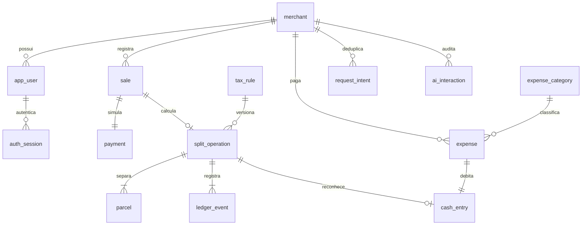

# Modelo PostgreSQL

[Dicionário por coluna, constraints e índices](BANCO-DICIONARIO.md), extraído do schema real por `src/test/.../DatabaseReport`. Regras adicionais em [V2](../src/main/resources/db/migration/V2__financial_guards.sql), privilégios em [V3](../src/main/resources/db/migration/V3__runtime_privileges.sql). Flyway é a única fonte de evolução estrutural; JPA valida o schema.

- Cada venda é uma intenção de pagamento mock única, não várias tentativas de adquirente. Tem exatamente um pagamento; pode não ter operação caso pagamento não confirmado ou regra ausente. Uma operação tem exatamente três parcelas (TAX/FEE/NET). Cardinalidades exigidas pelo serviço e, para parcelas, trigger diferido ao commit.
- Regra tem categoria, início de vigência e versão únicos. Não existe atualização; inclusão de nova versão ordenada determina a próxima regra. Snapshot na operação preserva os parâmetros originais.
- FKs compostas `(id,merchant_id)` impedem referências financeiras cruzadas. Não há cascade destrutivo. Role pertence ao usuário com exatamente uma loja nesta versão; acesso a múltiplas lojas exige contas/contextos separados.
- `request_intent` guarda chave/ação/hash/resposta original, atomicamente com o resultado. Estado e IDs são preservados no JSON; não há intenção PROCESSING separada nesta execução local síncrona. Constraint única mais advisory lock por chave evita corrida. Retomada também usa lock pessimista da operação.
- `ledger_event` é trilha auditável de eventos por operação. `cash_entry` é o realizado: origem única operação ou despesa; índice `(merchant_id,booked_on)` serve período/abertura. Eventos, movimentos, intenções e versões não podem ser reescritos pela API. Triggers protegem também contra alterações acidentais do proprietário.
- Categorias globais estáveis; runtime não pode renomear catálogo. Mudança futura exige migration e decisão de histórico/snapshot do nome. Não há ajuste manual de saldo; correções/compensações estão fora deste incremento.
- Consultas de operação/data e despesa/data usam índices compostos e desempate UUID. Busca parcial usa POSITION parametrizado; volume elevado exige medição antes de índice textual. Não há cache/materialização escondida.

## Operação e recuperação

Migrations V1..V3 em banco vazio e revalidação no reinício. Mudanças futuras são V4+; forward fix preferível a apagar histórico. Antes de atualização estrutural, backup e ensaio em cópia descartável; aplicação anterior só pode voltar se compatível com schema preservado. Nunca usar `ddl-auto=update` ou remover volumes como estratégia de rollback.

Backup/restore: scripts usam ferramentas PostgreSQL17 compatíveis e autenticação via variáveis PG*/`.pgpass`. Restore recusa schema public não vazio, não contém `DROP`/`--clean`. Arquivo é criado com umask077; retenção, criptografia externa e responsáveis operacionais seguem pendentes de acordo. Validar integridade das cadeias, FKs e contagens após restore. O launcher local é exclusivamente desenvolvimento; não substitui implantação segura com senha/TLS.
